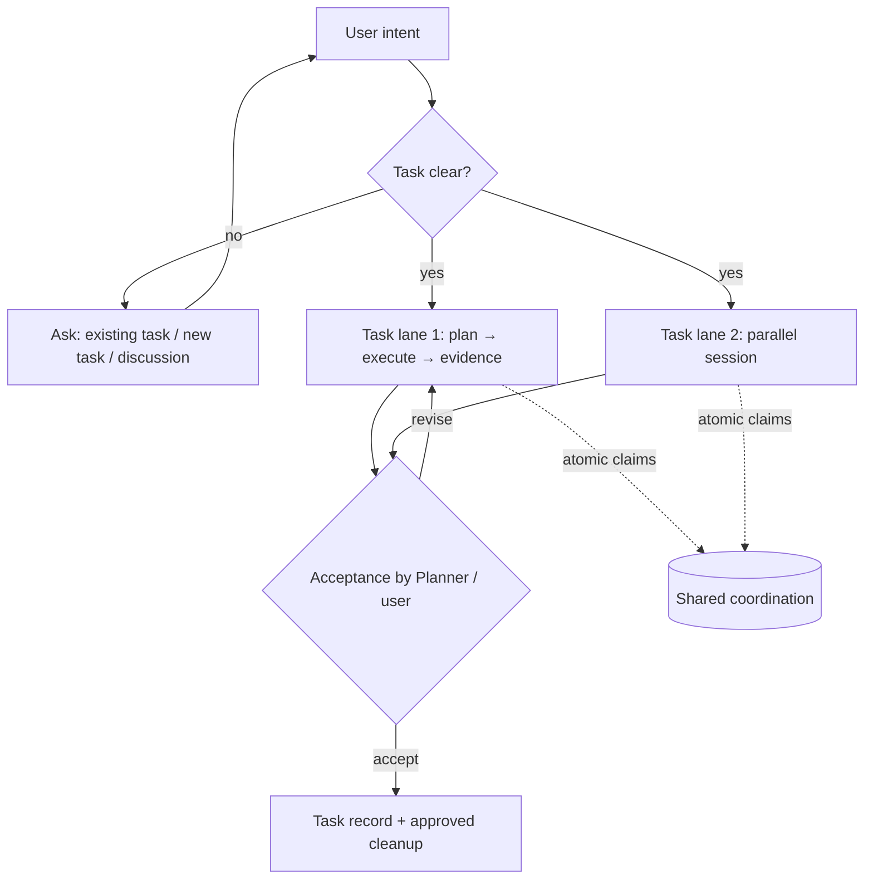

# blueberry

A private, lightweight, agent-first workflow kit for infrastructure development.
Reusable prompts, Markdown templates, explicit skills and a small coordination
helper—not an agent runtime, installer, scheduler or project-profile collection.

## Design philosophy

- **Human-in-the-loop:** ask at ambiguity, scope/risk changes, ownership conflicts,
  destructive retirement, acceptance and publication—not before every routine step.
- **Readable:** a small current snapshot, actionable next step and useful final task
  narrative; append history with the newest entry at the bottom.
- **Low contextual aggressiveness:** load a short router, then the selected task and
  relevant plan/evidence—never every board, role manual or raw log into every request.
- **Task isolation, shared coordination:** roles belong to tasks, not singleton
  project positions. Share only reservations, dependencies and project pointers.
- **Local-first:** checkpoint experiments locally; prepare reviewed publication
  history later. Local records and Git history are not secret stores.
- **Evidence and closure:** distinguish passing checks, failures, accepted exceptions
  and uncertainty. Completion includes a readable summary and artifact disposition.
- **Small mechanisms:** automate atomic updates, not judgment. No daemon, database,
  automatic job control, silent cleanup or self-modification of instructions.
- **Project-neutral:** no vendor, machine, model or repository profiles. Existing
  project rules and documentation structure remain authoritative in their project.

User/task-driven evolution is future-facing: observed friction → proposed change →
human approval → explicit merge → validation. Do not infer permanent rules silently.



## Layout in an adopting project

```text
COWORKERS.md                         # Small index and project pointers
.coworkers/
  WORKFLOW.md                        # On-demand workflow/user guide
  state/
    shared.md                        # Canonical reservations and protections
    tasks/<task_id>.md               # Current state, decisions, handoffs
    locks/                           # Persistent helper lock files, not job leases
  tasks/<task_id>/
    README.md                        # Durable task record and completion summary
    stages/NN_short_description.md   # Optional executable plans/findings
  tools/{coord.py,README.md}         # Local standard-library coordination helper
local_tests/<task_id>/<run_id>/      # Disposable output, not permanent knowledge
```

Adoption claims no existing project directory; records use their own namespace.
Preserve existing evidence paths instead of moving them for aesthetics.
Across worktrees, use one canonical coordination root; versioned records belong in
the task worktree, whose actual path is recorded in its state board.

## User guide

Start with the [workflow guide](toolkit/general/WORKFLOW.md). Typical requests:

| Intent | Request / behavior |
|---|---|
| Start/join | “Work on task `startup_latency` as Executor.” Confirm ambiguity/ownership. |
| Unclear task | Agent offers relevant existing tasks, a proposed new task, or discussion-only. |
| Parallel work | Separate sessions and preferably task worktrees; shared claims use one root. |
| Resume | Retain a clear session binding; refresh state or ask if uncertain. |
| Plan | Planner supplies steps, checks, scope, evidence and stop conditions without hidden context. |
| Execute/review | Update changed state and evidence; do not silently change acceptance. |
| Finish | Record outcome, reproduction, tests, evidence and keep/promote/delete/defer disposition. |
| Clean | Explicit task-scoped cleaner; project-wide only on a separate explicit request. |
| Publish | Preserve local history, prepare coherent reviewed commits, validate, then ask before push. |

Planner accepts/replans; Executor delivers evidence and owns its jobs; Reviewer is
optional. One person/session may fill several roles. Several Executors need distinct
work items. At meaningful request boundaries reconcile state and next action; do not
write no-op logs or rewrite the plan just because a message ended.

The [coordination helper guide](toolkit/general/tools/README.md) covers revision-checked
updates, claims, contention and recovery. It is cooperative, local-POSIX coordination,
not a security boundary or a replacement for live availability checks.

## Give this prompt to your agent

```text
Read <blueberry-checkout>/README.md and follow its agent setup procedure.
Set up blueberry in <target-repository> for the current agent harness.
If either path is missing or ambiguous, ask first; never guess or proceed.
Preserve existing instructions, boards, running work, reservations and evidence,
including unrelated harness resources such as settings, skills and extensions.
Ask before conflicts, task creation or migration. Use local copies, not symlinks.
Do not change global settings, run workloads/cleanup, or commit/push.
Validate, report created/preserved/skipped items, and explain reload requirements.
```

## Update an installation

Installed copies change only through this explicit flow; `git pull` never updates them.

```text
Read <blueberry-checkout>/README.md and update the existing blueberry installation in
<target-repository> for the current agent harness.
If a path is missing or ambiguous, or no installation exists, ask first.
Compare each installed asset with the source; propose an additive merge that preserves
local modifications, unrelated instructions and other harness resources.
Layout/board changes require the documented paused-writer migration; never mix a new
cleaner with an unmigrated live board. Do not run workloads, cleanup or commit/push.
Report applied, skipped and conflicting changes with required reload steps.
```

## Uninstall

Removal reverses only installed assets; coordination data and evidence are project history.

```text
Read <blueberry-checkout>/README.md and remove the blueberry installation from
<target-repository> for the current agent harness.
If a path is missing or ambiguous, ask first; inventory installed pieces before deleting.
Remove only installed instructions, skills, prompts, helper and workflow; revert only
blueberry-added ignore rules and merge sections. Restore anything ambiguous by asking.
Preserve COWORKERS.md, .coworkers/ records and state, local_tests and evidence by
default; deleting them requires explicit approval. Never stop jobs or delete evidence.
Validate and report removed, preserved and leftover items.
```

## Agent setup procedure

### 1. Inspect

Resolve the source checkout and target root (Git top-level where available); show
both. Do not install into blueberry itself unless explicitly requested. Inspect
existing instructions, boards, `.coworkers/`, ignore rules and relevant project docs.
Check inherited skills/prompts for collisions. Read the relevant
[harness notes](toolkit/specific/agent-specific/README.md); unknown harness loading
rules must be verified from official docs, not guessed. Reading a skill is not invoking it.

If an existing single-board workflow or any active writer would be affected, stop
before deployment and propose the separate migration below. Never mix a task-scoped
cleaner with an unmigrated board. Source changes do not update installed copies.

### 2. Select and explain

Use the [asset map](toolkit/README.md). Explain the intended files and preserve the
project's engineering instructions. Select only useful explicit skills and optionally
the harness's task-selection prompt. Choose one real canonical coordination root for
all participating worktrees; verify a suitable local POSIX filesystem before using
the helper. Do not promise distributed/network-filesystem locking guarantees.

### 3. Create or preserve

- Copy by default; never follow symlink destinations or parents when writing.
  Existing identical assets need no change. For differing instruction entry points,
  propose an additive, clearly marked merge that preserves every existing line; ask
  before reordering or removing anything. No competing instruction entry points.
- Treat unrelated harness resources (settings, extensions, prompts, skills, context
  files) as preserved context: inspect them, report collisions, never remove or
  override them to make room for blueberry.
- If absent and approved, copy the project index and shared-board templates, workflow
  guide and helper directory. Populate only verified context/root/namespace pointers.
  Do not invent task owners, resource availability, tests or example active claims.
- Create task state/records only for a selected, authorized task; optional stage docs
  are not mandatory bureaucracy. Use the helper for subsequent coordination writes.
- Existing boards remain byte-for-byte unchanged during ordinary setup, including on
  repeat setup. Record source revision, selected assets and harness in new setup provenance.
- Resolve the local exclude file with `git rev-parse --git-path info/exclude` (linked
  worktrees can have a `.git` file). Create the exclude file/parent if absent after
  checking for symlinks. Preserve effective rules and add only missing ones:
  `/COWORKERS.md`, `/.coworkers/state/`, `/.coworkers/tools/`, `/.coworkers/WORKFLOW.md`,
  and `/local_tests/` if this scratch policy is adopted. Do not modify tracked `.gitignore`.
- **Do not blanket-ignore `.coworkers/`.** Durable `.coworkers/tasks/` records remain
  eligible for explicit local commits. If broader existing ignore rules hide them,
  report the conflict; never silently force-add or change rules. Tracked state needs
  a user decision: ignores do not untrack files, and setup never runs `git rm`.
- Without Git, report unavailable exclusion/versioning; do not initialize automatically.
  Install harness resources only after checking precedence and project trust behavior.

### 4. Verify and report

Verify regular files, references, canonical root, skill frontmatter/names, duplicate
resource discovery, and explicit invocation. Check effective ignore rules with
`git check-ignore -v`; verify task records are not accidentally excluded, including
in linked worktrees. Confirm tracked `.gitignore` is unchanged. Preserve pre-existing
boards and report unresolved tracked/ignore/instruction conflicts, not success.

Review diffs: no unrelated changes, global settings, workload starts/stops, reservations,
artifact deletion or commits. Validate helper/templates in disposable fixtures, not by
running a real cleanup or claiming live devices. Report created/preserved/skipped items,
remaining conflicts and harness reload steps. Do not claim interactive discovery or
model behavior that was not exercised.

## Migration and updates

Existing installed copies update by approved comparison/merge, not symlinks or `git pull`.
Migration requires a paused-writer window and participant agreement. Preserve a recovery
copy; split task/shared content without losing constraints, evidence paths, timestamps
or attribution; review history into bottom-latest order once, preserving ties and
uncertainty. No automatic evidence movement, cleanup, ownership transfer or job restart.
Publish canonical pointers, merge prompts/skills consistently, and reload/rebind all
participating sessions before resuming writers. If work cannot pause, defer migration.

For publication, local-only task records must be absent from the entire published
history when not approved—not merely removed in its last commit. See the workflow
Git section. The optional `package.json` exports only general skills; it neither
initializes this layout nor authorizes upgrading a legacy live installation.

## Validation and compatibility

Run isolated checks from this checkout:

```bash
PYTHONDONTWRITEBYTECODE=1 python -m unittest discover -s tests -v
```

See the [test guide and future context-footprint matrix](tests/README.md). Static
prompt-size checks and filesystem concurrency tests are not proof of an LLM's task
selection or a harness's actual request payload. Pi loading rules are documented;
interactive multi-agent footprint measurements and other harness adapters remain
explicit validation work, not claimed compatibility.
