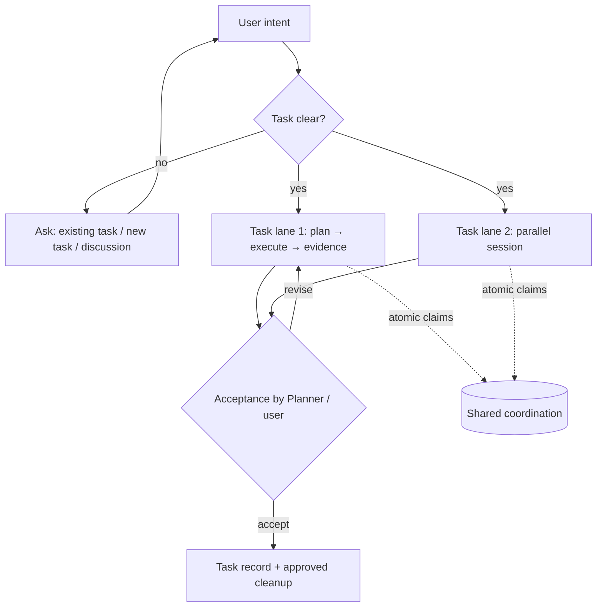

# blueberry

A private, lightweight, agent-first workflow kit for infrastructure development.
Reusable prompts, Markdown templates, explicit skills and a small coordination
helper—not an agent runtime, installer, scheduler or project-profile collection.

## Design philosophy

- **Human-in-the-loop:** ask at ambiguity, scope/risk changes, ownership conflicts,
  destructive retirement, acceptance and publication—not before every routine step.
- **Readable:** a small current snapshot, actionable next step and useful final task
  narrative; append history with the newest entry at the bottom.
- **Low contextual aggressiveness:** load a short router, then the selected task and
  relevant plan/evidence—never every board, role manual or raw log into every request.
- **Task isolation, shared coordination:** roles belong to tasks, not singleton
  project positions. Share only reservations, dependencies and project pointers.
- **Local-first:** checkpoint experiments locally; prepare reviewed publication
  history later. Local records and Git history are not secret stores.
- **Evidence and closure:** distinguish passing checks, failures, accepted exceptions
  and uncertainty. Completion includes a readable summary and artifact disposition.
- **Small mechanisms:** automate atomic updates, not judgment. No daemon, database,
  automatic job control, silent cleanup or self-modification of instructions.
- **Project-neutral:** no vendor, machine, model or repository profiles. Existing
  project rules and documentation structure remain authoritative in their project.

User/task-driven evolution is future-facing: observed friction → proposed change →
human approval → explicit merge → validation. Do not infer permanent rules silently.



## Layout in an adopting project

```text
AGENTS.md                            # Shared router entry point (marked additive merge)
.agents/skills/<name>/SKILL.md       # Shared explicit skills (Pi + Antigravity)
COWORKERS.md                         # Small index and project pointers
.coworkers/
  WORKFLOW.md                        # On-demand workflow/user guide
  state/
    shared.md                        # Canonical reservations and protections
    tasks/<task_id>.md               # Current state, decisions, handoffs
    locks/                           # Persistent helper lock files, not job leases
  tasks/<task_id>/
    README.md                        # Durable task record and completion summary
    stages/NN_short_description.md   # Optional executable plans/findings
  tools/{coord.py,README.md}         # Local standard-library coordination helper
local_tests/<task_id>/<run_id>/      # Disposable output, not permanent knowledge
```

Adoption claims no existing project directory; records use their own namespace.
Preserve existing evidence paths instead of moving them for aesthetics.
Across worktrees, use one canonical coordination root; versioned records belong in
the task worktree, whose actual path is recorded in its state board.

## Supported harnesses

Pi, Antigravity and Codex share `AGENTS.md` and `.agents/skills/`; Claude Code shares
`AGENTS.md` when no `CLAUDE.md` exists (otherwise uses `.claude/rules/blueberry.md`) and
uses `.claude/skills/`. Full rules and lifecycle steps live in [INSTALL.md](INSTALL.md)
and [harness notes](toolkit/specific/agent-specific/README.md):

| Harness | Router entry point | Skills | Optional `/task` | Adapter |
|---|---|---|---|---|
| **Pi (`1.6.x`)** | `AGENTS.md` (marked merge) | `.agents/skills/<name>/` | `.pi/prompts/task.md` (`/task`) | [pi/README.md](toolkit/specific/agent-specific/pi/README.md) |
| **Antigravity (`1.5.x`)** | `AGENTS.md` (marked merge) | `.agents/skills/<name>/` | `.agents/skills/task/` (`/task`) | [antigravity/README.md](toolkit/specific/agent-specific/antigravity/README.md) |
| **Codex CLI** | `AGENTS.md` (marked merge) | `.agents/skills/<name>/` (`openai.yaml`) | `.agents/skills/task/` (`$task`) | [codex/README.md](toolkit/specific/agent-specific/codex/README.md) |
| **Claude Code (`v2.1.277+`)** | `AGENTS.md` or `.claude/rules/blueberry.md` | `.claude/skills/<name>/` | `.claude/skills/task/SKILL.md` (`/task`) | [claude-code/README.md](toolkit/specific/agent-specific/claude-code/README.md) |
| **Other harnesses** | Verify official docs first | Verify explicit discovery | Optional | [agent-specific/README.md](toolkit/specific/agent-specific/README.md) |

## User guide

Start with the [workflow guide](toolkit/general/WORKFLOW.md). Typical requests:

| Intent | Request / behavior |
|---|---|
| Start/join | “Work on task `startup_latency` as Executor.” Confirm ambiguity/ownership. |
| Unclear task | Agent offers relevant existing tasks, a proposed new task, or discussion-only. |
| Parallel work | Separate sessions and preferably task worktrees; shared claims use one root. |
| Resume | Retain a clear session binding; refresh state or ask if uncertain. |
| Plan | Planner supplies steps, checks, scope, evidence and stop conditions without hidden context. |
| Execute/review | Update changed state and evidence; do not silently change acceptance. |
| Finish | Record outcome, reproduction, tests, evidence and keep/promote/delete/defer disposition. |
| Clean | Explicit task-scoped cleaner; project-wide only on a separate explicit request. |
| Publish | Preserve local history, prepare coherent reviewed commits, validate, then ask before push. |

Planner owns scope, design, core/complex implementation when appropriate, and acceptance
verdicts; Executor handles delegated bounded slices, test/benchmark runs, evidence and its
jobs; Reviewer is optional (especially useful when Planner wrote core code). Roles are
harness-agnostic—any agent or human may fill any role, and one session may fill several.
Several Executors need distinct work items. At meaningful request boundaries reconcile
state and next action; do not write no-op logs or rewrite the plan just because a message
ended.

The [coordination helper guide](toolkit/general/tools/README.md) covers revision-checked
updates, claims, contention and recovery. It is cooperative, local-POSIX coordination,
not a security boundary or a replacement for live availability checks.

## Give this prompt to your agent

```text
Read <blueberry-checkout>/INSTALL.md and follow its Setup procedure.
Set up blueberry in <target-repository> for the current agent harness (or specify pi / antigravity / codex / claude-code).
If either path or the target harness is missing or ambiguous, ask first; never guess or proceed.
Preserve existing instructions, boards, running work, reservations and evidence,
including unrelated harness resources in AGENTS.md, CLAUDE.md, .agents/, .pi/ and .claude/.
Ask before editing a Git-tracked AGENTS.md or CLAUDE.md, resolving conflicts, creating tasks or migrating.
Use local copies, not symlinks. Do not change global settings, run workloads/cleanup, or commit/push.
Validate, report created/preserved/skipped items, and explain reload requirements.
```

## Update an installation

Installed copies change only through the explicit [update procedure](INSTALL.md#update-procedure);
`git pull` never updates them.

```text
Read <blueberry-checkout>/INSTALL.md and follow its Update procedure for
<target-repository> and its installed harness(es).
If a path or harness is missing or ambiguous, or no installation exists, ask first.
Compare each installed asset with the source; propose an additive merge that preserves
local modifications, unrelated instructions and other harness resources (including
clean migration from legacy .pi/APPEND_SYSTEM.md or .pi/skills/ copies after approval).
Layout/board changes require the documented paused-writer migration; never mix a new
cleaner with an unmigrated live board. Do not run workloads, cleanup or commit/push.
Report applied, skipped and conflicting changes with required reload steps.
```

## Uninstall

Removal follows the [uninstall procedure](INSTALL.md#uninstall-procedure) and reverses
only installed assets; coordination data and evidence are project history.

```text
Read <blueberry-checkout>/INSTALL.md and follow its Uninstall procedure to remove the
blueberry installation from <target-repository> for the requested harness(es).
If a path or harness is missing or ambiguous, ask first; inventory installed pieces before deleting.
Remove only installed blueberry router blocks, skills, prompts, helper and workflow;
revert only blueberry-added ignore rules. Restore anything ambiguous by asking.
Preserve COWORKERS.md, .coworkers/ records and state, local_tests and evidence by
default; deleting them requires explicit approval. Never stop jobs or delete evidence.
Validate and report removed, preserved and leftover items.
```

## Agent setup summary

Full step-by-step instructions, multi-harness coexistence rules, selective `info/exclude`
patterns and migration gates are in [INSTALL.md](INSTALL.md):

1. **Inspect:** verify `<blueberry-checkout>`, `<target-repository>` and target harness
   adapter ([pi](toolkit/specific/agent-specific/pi/README.md),
   [antigravity](toolkit/specific/agent-specific/antigravity/README.md)); stop if an
   unmigrated board or active writer would be affected.
2. **Select and explain:** map generic assets ([toolkit/README.md](toolkit/README.md)),
   shared `AGENTS.md` + `.agents/skills/` targets, optional `/task` helper and one local
   POSIX coordination root across worktrees.
3. **Create or preserve:** copy regular files, merge `AGENTS.md` inside
   `<!-- blueberry:router:start -->` / `<!-- blueberry:router:end -->` markers (asking
   first if `AGENTS.md` is Git-tracked), record setup provenance in `COWORKERS.md`, and
   update `git rev-parse --git-path info/exclude` selectively without blanket-ignoring
   `.coworkers/`, `.agents/` or `.pi/` or editing tracked `.gitignore`.
4. **Verify and report:** verify links, skill frontmatter, duplicate discovery, and
   `git check-ignore -v` (confirming `.coworkers/tasks/` and tracked `.agents/` files stay
   unignored), then report changes and harness reload commands.

For publication, local-only task records must be absent from the entire published
history when not approved—not merely removed in its last commit (see
[WORKFLOW.md](toolkit/general/WORKFLOW.md)). The optional `package.json` exports only
general skills for Pi; it neither initializes `.coworkers/` nor authorizes upgrading a
legacy live installation.

## Validation and compatibility

Run isolated checks from this checkout:

```bash
PYTHONDONTWRITEBYTECODE=1 python3 -m unittest discover -s tests -v
```

See the [test guide and context-footprint matrix](tests/README.md). Static prompt-size
checks and filesystem concurrency tests are not proof of an LLM's task selection. Pi
(`1.6.x`) and Antigravity (`1.5.x`) loading rules are documented, and Pi Tier A request
assembly is measured against `AGENTS.md` + `.agents/skills/`; interactive multi-agent
behavior, Antigravity request-assembly capture and Tier B model runs remain explicit
validation work, not claimed compatibility.
